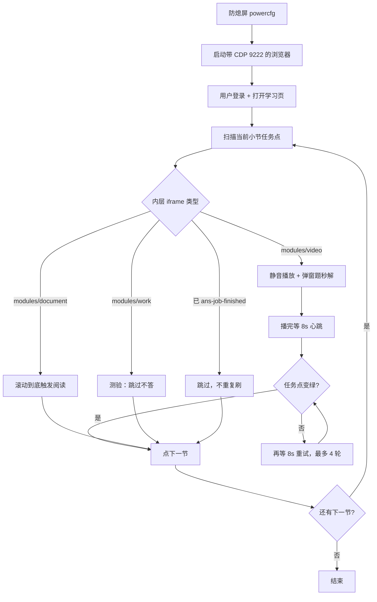

# chaoxing-auto-study

> 超星学习通 / 泛雅 / 尔雅 网课自动化技能包 —— 接管浏览器、识别任务点、静音播放、心跳校验、自动推进。
> 以 **AI Agent Skill**（WorkBuddy / Claude Skills）的形式组织，也可以脱离 Agent 直接当命令行脚本用。


---

## 这是什么

一个把「超星网课挂机」这件事工程化的技能包。它不是那种"一键秒过"的脚本——超星只认**播放心跳**，
拖进度条、改 `currentTime` 都不会记录进度，还可能触发风控。所以这里的思路是：

**老老实实播，但把「盯屏幕、点弹窗、切下一节」这些重复劳动全自动化。**

核心能力：

| 能力 | 说明 |
| :--- | :--- |
| 🖥️ 浏览器接管 | 通过 CDP（`--remote-debugging-port`）接管已登录的 Chrome，不碰账号密码 |
| 🪟 多层 iframe 穿透 | `studentstudy` → `knowledge/cards` → `modules/video` 三层，同源主世界注入 |
| ▶️ 视频自动播放 | 静音播放、暂停自动唤回、倍速可选（默认 1.0，见下方说明） |
| ❓ 弹窗题秒解 | 视频中途弹出的互动题自动勾选 + 提交，不卡播放 |
| ✅ 变绿校验 | 播完等心跳 → 校验任务点是否变绿 → 未绿自动重试，不盲目切章 |
| ⏭️ 已完成跳过 | 已带 `ans-job-finished` 的卡片直接跳过，**不重复刷** |
| 📄 文档通关 | 课件 / PDF 内层 iframe 滚动到底，触发阅读进度上报 |
| 🧪 测验跳过 | 纯刷课模式：章节测验不答不提交，自动跨过（也可接题库答题） |
| 🔁 断线自愈 | WebSocket 断开 5 秒重连，页面刷新 / 切章不中断循环 |
| 😴 防熄屏 | 一条 `powercfg` 关掉熄屏与待机，长时挂机不断线 |

---

## 工作原理



### iframe 层级（关键）

```text
studentstudy (顶层，可执行 JS)
└── iframe#iframe            src = knowledge/cards      ← 任务点卡片层
    └── iframe               src = ananas/modules/video|work|document
        └── (video 层)       <video> 元素在这里
```

> ⚠️ **类型判断必须用内层 iframe 的 `src`**。外层 `knowledge/cards` 的 src 恒为 `cards`，
> 用它判断只会得到 `other`，表现为"脚本在跑但什么任务点都不识别"——这是最难排查的一个坑。

---

## 快速开始

### 0. 环境要求

- Windows（防熄屏脚本是 `powercfg`，其他平台可跳过）
- Python 3.8+，`pip install websocket-client`
- Node 16+（仅 `auto_runner.js` 需要，`npm i puppeteer`）
- Chrome / Edge

### 1. 防熄屏（挂机前必做）

```powershell
powercfg /change monitor-timeout-ac 0
powercfg /change standby-timeout-ac 0
powercfg /change monitor-timeout-dc 0
powercfg /change standby-timeout-dc 0
# 或直接运行 scripts/keep_awake.ps1
```

### 2. 启动带调试端口的浏览器

Chrome 120+ 不允许在默认 `User Data` 目录开调试端口，必须用独立配置目录：

```cmd
"D:\Chrome\Application\chrome.exe" ^
  --remote-debugging-port=9222 ^
  --remote-allow-origins=* ^
  --user-data-dir="D:\chrome_debug_profile" ^
  --start-maximized "https://i.chaoxing.com"
```

验证：浏览器访问 <http://127.0.0.1:9222/json/version> 能返回 JSON 即成功。
（参考脚本：`scripts/launch_browser.cmd`）

### 3. 登录并打开学习页

手动登录学习通 → 进入课程 → 打开任意小节，让地址栏出现 `studentstudy?...chapterId=...`。
**这个标签页不要关**，脚本靠它定位。

### 4. 跑起来

```bash
# 推荐：单进程全自动循环（默认 1.0 倍速，一路刷到课程末尾）
python scripts/auto_loop_cdp.py --port 9222 --log run.log

# 想要 2 倍速（会被播放器周期性重置回 1x，别指望稳定）
python scripts/auto_loop_cdp.py --speed 2

# Node 版：按目录清单逐节跑，带进度持久化
node -e "require('./scripts/auto_runner.js').runCourse({sections:[...], baseUrl:'https://mooc1.chaoxing.com/mycourse/studentstudy?...'})"
```

### 5. 参数说明

| 参数 | 默认 | 说明 |
| :--- | :--- | :--- |
| `--port` | `9222` | CDP 调试端口 |
| `--speed` | `1.0` | 播放倍速。超星风控会周期性重置回 1x，强推 2x 收益不稳定 |
| `--tab-match` | `studentstudy` | 用于定位标签页的 URL 关键字 |
| `--log` | 空 | 日志文件路径，追加写入 |
| `--heartbeat-wait` | `8` | 播完后等待心跳回传的秒数 |

环境变量 `CHAO_XING_SPEED` 可给 Node 版设置倍速。

---

## 目录结构

```text
chaoxing-auto-study/
├── SKILL.md                      # Agent Skill 主文档（含流程图、步骤、排错表）
├── README.md
├── scripts/
│   ├── auto_loop_cdp.py          # ⭐ 单进程全自动循环（推荐）
│   ├── auto_runner.js            # Node 批量遍历版（目录清单驱动）
│   ├── keep_awake.ps1            # 防熄屏
│   └── launch_browser.cmd        # 带调试端口启动浏览器
└── references/
    └── chaoxing_internals.md     # 超星页面结构 / 接口内部细节速查
```

---

## 实测踩过的坑（本项目的核心价值）

这些不是推导出来的，是真机跑一整天遇到的，脚本里都已修正：

| # | 症状 | 根因 | 修正 |
| :-- | :--- | :--- | :--- |
| 1 | 脚本在跑但永远识别不到任务点（`type=other`） | 用外层 `knowledge/cards` 的 src 判类型 | 改用内层 iframe 的 `modules/*` |
| 2 | 视频播完后僵死，永不推进 | 结束态计时器 `ended_ts` 每轮被重置，等不满 8 秒 | 结束态只赋值一次，独立状态机 |
| 3 | 播完了，任务点却没变绿 | 心跳未回传就切章 | 8s 后校验 `.ans-job-finished`，未绿每 8s 重试，最多 4 轮 |
| 4 | 连续多轮 `chapterId` 完全不变 | "还有任务点未完成"确认弹窗没点 | 点 `.nextChapter` 或可见的"下一节"**叶子节点**（避免嵌套误匹配） |
| 5 | 倍速总被改回 1x | 播放器风控周期性重置 `playbackRate`，自带倍速菜单被隐藏 | 默认 1.0，不强推 |
| 6 | 鼠标移开 / 切窗口视频就停 | 心跳上报 + 失焦触发 `paused`，短 3~6s，长可达 70s | 每 3s 巡检验 `paused` 并唤回 `play()`，**不要判卡死** |
| 7 | 视频没播完任务点就变绿了 | 超星按累计观看量算达标，历史进度也算 | 正常现象，绿了就是通过，别重复刷 |
| 8 | 已完成视频被重播一遍 | 只判断目录 `icon_Completed`，没判卡片级 | 卡片级 `.ans-job-finished` 也必须跳过 |
| 9 | 长视频被误杀 | 单视频超时写死 35 分钟 | 按时长动态算：`max(40min, 时长 + 15min)` |
| 10 | CDP 注入的守卫没生效 | 隔离世界（isolated world）执行，断开连接即销毁 | 从顶层同源主世界穿透注入 |

---

## FAQ

**Q：为什么不能直接改 `currentTime` 跳到最后？**
超星靠 `/multimedia/log/a/...` 心跳上报累计观看时长，跳进度不会产生有效心跳，任务点不会变绿，还容易进风控名单。

**Q：为什么章节测验跳过后，目录还显示"N 个待完成任务点"？**
因为待完成里包含了测验。视频任务点会一个个变绿，测验需要单独做。这是预期现象，不是刷课失败。

**Q：会不会被检测到？**
脚本是真实播放，不改请求、不伪造上报，属于"自动化操作浏览器"。但平台仍有行为风控（播放时长/频率异常检测），
**无法保证零风险**，请自行判断。

**Q：能刷别的平台吗？**
架构（CDP + iframe 穿透 + 心跳校验）是通用的，换掉选择器和 URL 规则即可适配，但具体适配需要自己调试。

**Q：支持 macOS / Linux？**
CDP 部分完全跨平台，只有 `keep_awake.ps1` 是 Windows 专用，可换 `caffeinate -d` / `systemd-inhibit`。

---

## 更新日志

### v1.1.0
- 新增 `scripts/auto_loop_cdp.py`：参数化单进程全自动循环，合并"播放→心跳→校验→推进→跳过"全链路
- 修复 iframe 层级判断错误（`type` 恒为 `other`）
- 修复 `ended_ts` 每轮重置导致播完僵死
- 播完后增加任务点变绿校验与重试
- 新增未完成任务点确认弹窗处理
- 默认倍速由 2.0 改为 1.0（风控会重置，强推无意义）

### v1.0.0
- 初版：防熄屏、CDP 接管、iframe 穿透、弹窗题秒解、文档滚动、测验跳过

---

## 免责声明

- 本项目仅供**个人学习研究与自动化技术交流**，用于学习如何做浏览器自动化、CDP 协议、多 iframe 穿透。
- 使用本项目产生的任何后果由使用者自行承担；请遵守所在学校的学术规范与超星平台的服务条款。
- **请勿**用于代刷课、售卖刷课服务等商业或代他人操作场景。
- 项目不含任何题库、账号、破解内容。

## License

[MIT](./LICENSE)
