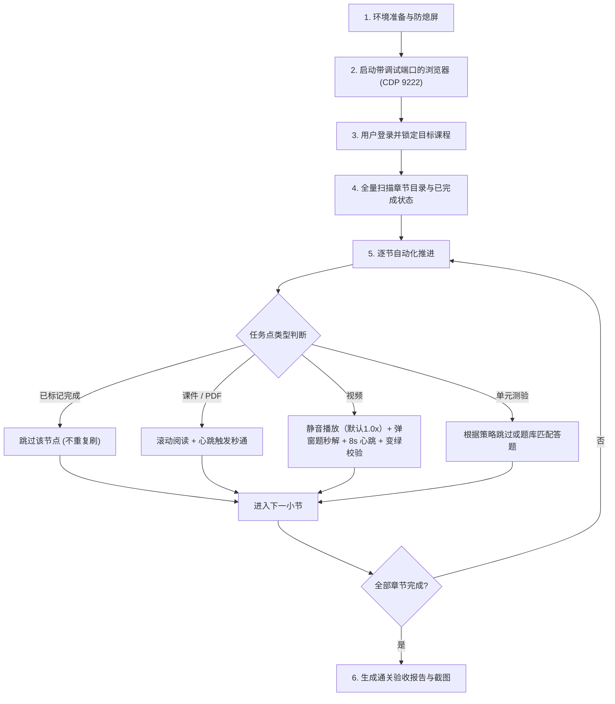

# 超星学习通全自动刷网课 Skill 指南

本 Skill 沉淀了超星平台（泛雅 / 尔雅 / 学习通）网课自动化的完整落地流程与规避风控的最佳实践。

> **先读这段**：本文档中标记 ⚠️ 的地方都是真机实测踩过的坑，脚本已按"实测修正"实现，
> 不要凭直觉改回看似更简洁的写法。

## 推荐执行方式（按优先级）

| 方式 | 适用场景 | 入口 |
| :--- | :--- | :--- |
| **单进程全自动循环（首选）** | 挂机刷完整门课，无需人工衔接 | `scripts/auto_loop_cdp.py` |
| Node 批量遍历 | 需要按目录清单逐节跑、要进度持久化 | `scripts/auto_runner.js` |

```bash
# 全自动循环：默认 1.0 倍速，遇到测验跳过，播完自动推进直到课程末尾
python scripts/auto_loop_cdp.py --port 9222 --log run.log

# 需要 2 倍速时显式开启（超星会周期性重置回 1x，别指望稳定 2x）
python scripts/auto_loop_cdp.py --speed 2
```

---

## 核心流程与执行步骤



---

## 第一步：Windows 系统防熄屏锁定（挂机前必备）

长周期挂机最容易因为电脑黑屏、休眠导致网络断开或浏览器挂起。

* **执行命令**：
  运行 [keep_awake.ps1](./scripts/keep_awake.ps1) 或在 PowerShell 中执行：
  ```powershell
  powercfg /change monitor-timeout-ac 0
  powercfg /change standby-timeout-ac 0
  powercfg /change monitor-timeout-dc 0
  powercfg /change standby-timeout-dc 0
  ```
* **验证状态**：
  确认 `VIDEOIDLE` 与 `STANDBYIDLE` 均为 `0x00000000`（永不熄屏、永不待机）。

---

## 第二步：启动自动化调试浏览器（CDP 端口 9222）

日常双击打开的 Chrome / Edge 受系统沙盒保护，外部程序无法直接注入。必须通过特定参数拉起：

1. **规避 Chromium 调试限制**：
   * 现代 Chrome (120+) 禁止在默认 `User Data` 目录启用 `--remote-debugging-port`，且加密 Cookies 绑定路径。
   * **最佳实践**：使用独立的调试配置目录，如 `--user-data-dir="D:\chrome_debug_profile"`。
2. **解决交互桌面 Session 隔离问题**：
   * 通过 Windows 任务计划程序 (`schtasks`) 在前台用户会话中启动，确保前台最大化显示窗口供用户扫码。
   * 参考启动脚本：[launch_browser.cmd](./scripts/launch_browser.cmd)。
   ```cmd
   "D:\Chrome\Application\chrome.exe" --remote-debugging-port=9222 --remote-allow-origins=* --user-data-dir="D:\chrome_debug_profile" --start-maximized "https://i.chaoxing.com"
   ```
3. **连接验证**：
   * 访问 `http://127.0.0.1:9222/json/version` 确认端口连通。

---

## 第三步：课程定位与参数提取

用户登录后，进入课程详情页（`mooc2-ans.chaoxing.com/mooc2-ans/mycourse/stu`），从 URL 中提取 5 大核心参数：
* `courseid`：课程 ID
* `clazzid`：班级 ID
* `cpi`：用户唯一标识
* `enc`：动态加密密钥
* `openc`：开放密钥

*学习页基础 URL 范式*：
```text
https://mooc1.chaoxing.com/mycourse/studentstudy?chapterId={chapterId}&courseId={courseId}&clazzid={clazzId}&cpi={cpi}&enc={enc}&mooc2=1&hidetype=0&fanyaVersion=0&openc={openc}
```

---

## 第四步：已刷检测与任务点遍历（不重复刷）

### 1. 目录级跳过判断
在右侧目录 `#cells` 中定位每个章节节点 `#cur{chapterId}`：
* 若包含 `.icon_Completed`：说明该小节**全部任务点已通关**，直接跳过。

### 2. 卡片级跳过判断
对于未完全绿标的小节，进入页面穿透 `knowledge/cards` Iframe：
* 检查每个任务容器 `.ans-attach-ct`：
  * 若具有类名 `.ans-job-finished`：说明此任务点**已完成**，直接跳过。
  * 仅对**未包含** `.ans-job-finished` 的视频或文档进行处理。

---

## 第五步：自动化刷课核心逻辑（视频与文档）

* 单进程全自动循环：[auto_loop_cdp.py](./scripts/auto_loop_cdp.py)
* Node 批量遍历：[auto_runner.js](./scripts/auto_runner.js)

### 0. ⚠️ 类型判断必须用【内层】iframe 的 src

```javascript
const outer = document.querySelector('#iframe');        // knowledge/cards 层
const doc = outer.contentDocument;
const inner = doc.querySelector('iframe');              // 内层：modules/video|work|document
const src = inner ? inner.src : '';
// 正确：用 inner.src 判断 video / work / document
// 错误：用 outer.src 判断，它永远是 "knowledge/cards"，只会得到 other，循环会一直空转
```
> 这是最容易写错、也最难从日志看出来的一处：表现为"脚本在跑但永远不识别任何任务点"。

### 1. 视频多层 Iframe 穿透与控制
* **Iframe 路径**：
  `studentstudy` -> `iframe(knowledge/cards)` -> `iframe(ans-insertvideo-online)` -> `iframe(/ananas/modules/video/index.html)`
* **播放控制（video.js / HTML5）**：
  ```javascript
  const v = document.querySelector('video');
  if (v) {
    v.muted = true;             // 必须静音，防止浏览器阻止自动播放
    v.playbackRate = 1.0;       // 默认 1.0；2.0 会被风控重置，见下方说明
    v.play();
  }
  const btn = document.querySelector('.vjs-big-play-button');
  if (btn) btn.click();
  ```
* **⚠️ 倍速不要死磕**：实测超星播放器会"周期性把 `playbackRate` 重置回 1x"，
  且自带倍速菜单被风控隐藏。强推 2.0 的收益不稳定，还可能踩风控。
  默认按 1.0 真实时长播放；用户明确要求时才用 `--speed 2`，并接受被重置。
* **暂停是常态**：心跳上报、切前台、缓冲都会触发 `paused`，短则 3~6 秒，长可达 60~70 秒。
  每轮巡检唤回 `play()` 即可，**不要因为短暂暂停就判定卡死或切章**。

### 2. 视频弹窗互动测验秒解
视频播到特定时间点常会弹出选择题中断播放。每 3 秒检测一次：
```javascript
const quiz = document.querySelector('.ans-videoquiz, #videoquiz, .videoquiz');
if (quiz) {
  // 自动勾选首个选项
  const opt = quiz.querySelector('input[type="radio"], input[type="checkbox"], .ans-videoquiz-opt, li');
  if (opt) opt.click();
  // 自动点击提交关闭
  const submitBtn = quiz.querySelector('.ans-videoquiz-submit, button, .btn');
  if (submitBtn) submitBtn.click();
}
```

### 3. 多媒体心跳同步（防掉进度）
* 当视频达到终点（`v.ended || cur >= dur - 1`）：
* **必须等待 8 秒**，让超星的 `/multimedia/log/a/...` 心跳数据完全上报至服务器后再切换下一节。
* **⚠️ 8 秒不够就校验，别盲等**：8 秒后重新读 `.ans-attach-ct` 是否带 `.ans-job-finished`：
  * 已变绿 → 切下一节；
  * 未变绿 → 说明心跳未回传，再等 8 秒重试，最多 4 轮；仍不绿则记录 WARN（可能是网络或视频未真正播完）。
* **⚠️ 计时器状态机别每轮重置**：`ended_ts` 只在"进入结束态"时赋值一次，
  循环里若无脑 `ended_ts = null` 会导致"永远等不满 8 秒"，表现为视频播完后僵死不动。

### 4. 课件与 PDF 通关
* 定位文档类 Iframe（`modules/document` 或含 `docid`），执行
  `body.scrollTop = body.scrollHeight` 且同时设置 `documentElement.scrollTop`，停留 3 秒触发阅读进度上报。
* 只滚外层 cards iframe 是无效的——阅读进度在文档内层 iframe 里统计。

### 5. ⚠️ 未完成任务点确认弹窗
点"下一节"时，若本节还有未完成任务（典型就是**跳过的测验**），会弹出
**"当前章节还有任务点未完成，是否去完成？"**。此时按钮在弹窗里：

```javascript
// 优先专用类名
const nc = document.querySelector('.nextChapter');
if (nc && nc.offsetParent !== null) nc.click();
// 兜底：全局找可见的、无子元素的"下一节"文本节点（避免匹配到外层容器）
```
> 不处理这个弹窗，就会一直卡在当前小节，日志看起来一切正常但章节号不变——
> 判别方法：连续多轮 `chapterId` 完全相同且都在 quiz 分支。

---

## 第六步：章节测验与作业策略

1. **纯刷课模式**：识别到测验卡片（含有 `work/dowork` 或 `TiMu`）时跳过不提交。
   * 注意：跳过后目录里该小节**仍显示"N 个待完成任务点"**，这是预期现象，不是刷课失败。
2. **答题模式**：
   * 结合用户提供的题库文档（如 DOCX/ZIP/PDF）。
   * 题目使用模糊文字匹配（去掉标点与序号）。
   * 选项优先读取 `aria-label` 规避超星前台选项乱序混淆。
   * 提交前执行选项二次核对并截图留存。

---

## 核心排错速查表

| 症状 | 根本原因 | 解决方案 |
| :--- | :--- | :--- |
| **`enc校验失败`** | 直接拼接 URL 导致加密 token 不一致 | 从课程主页点击章节，或通过 `toOld()` 接口生成的合法 URL 跳转 |
| **浏览器端口连不上** | 默认目录限制或进程残留 | 使用独立 `--user-data-dir` 并通过 `schtasks` 在前台启动 |
| **脚本在跑但识别不到任务点（type=other）** | 用了外层 `knowledge/cards` 的 src 判断类型 | 改用内层 iframe 的 src（`modules/video|work|document`） |
| **视频卡在某秒不动** | 触发了视频内嵌互动测验 | 检测 `.ans-videoquiz`，自动点击选项并提交跳过 |
| **视频播完任务点没绿** | 切章太快，心跳未回传 | 8 秒后**校验** `.ans-job-finished`，未绿则每 8 秒重试，最多 4 轮 |
| **视频播完循环僵住不推进** | `ended_ts` 每轮被重置，永远等不满心跳窗口 | 结束态只赋值一次，用独立状态机 |
| **连续多轮 chapterId 不变** | 未处理"还有任务点未完成"确认弹窗 | 点弹窗内 `.nextChapter` 或可见的"下一节"叶子节点 |
| **倍速总被改回 1x** | 播放器风控周期性重置 `playbackRate` | 默认 1.0 播放，不强推 2x |
| **ElementHandle.click 假死** | 跨域/跨层 iframe 坐标计算死锁 | 使用 `evaluate(() => el.click())` 或直接调用 `video.play()` |
| **鼠标移开/切窗口后视频暂停** | 心跳上报与失焦导致 `paused` | 每 3 秒巡检唤回 `play()`；长暂停（≤70s）属正常，勿切章 |

